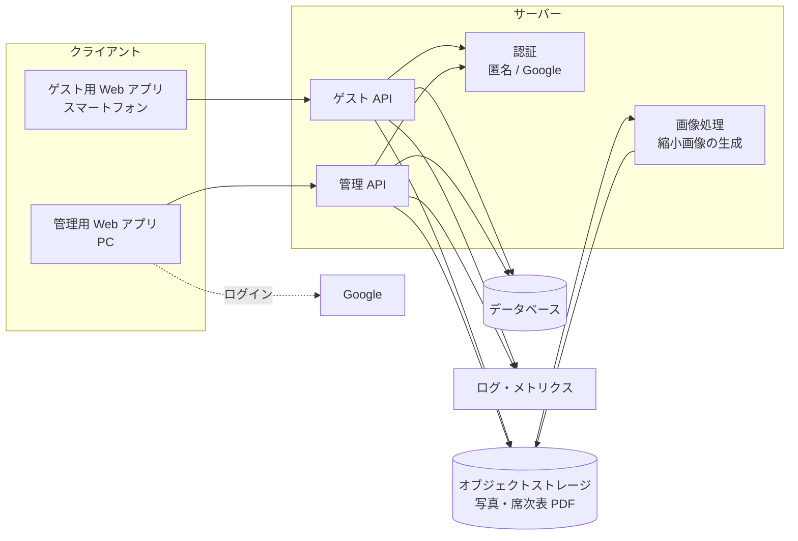

# アーキテクチャ

技術スタックは未選定（[D-01](../open-questions.md)）。
本書では技術に依存しない論理構成と、技術選定の評価軸・候補を整理する。
選定の結論は [ADR-0001](../adr/README.md) として記録する。

## 論理構成

| 構成要素 | 役割 | 関連 |
|---|---|---|
| ゲスト用 Web アプリ | 参加者向けの画面。スマートフォンのブラウザで動く | [screens.md](screens.md) |
| 管理用 Web アプリ | 管理面の画面。ゲスト用とは別のオリジンで提供する | [multi-tenancy.md](multi-tenancy.md) |
| ゲスト API | 参加、ニックネーム、写真、いいね、ランキング。すべてのリクエストでセッションとテナントを検証する | [auth.md](auth.md) |
| 管理 API | テナント、コンテンツ、参加 URL、監視 | FR-A-01〜FR-A-10 |
| 認証 | 参加者の匿名セッションの発行、Google 認証と許可リストの照合 | [auth.md](auth.md) |
| 画像処理 | アップロードされた写真から縮小画像を作る | NFR-07 |
| データベース | テナント、参加者、写真のメタデータ、いいね | [domain-model.md](domain-model.md) |
| オブジェクトストレージ | 写真（オリジナル・縮小画像）と席次表 PDF。公開しない | [multi-tenancy.md](multi-tenancy.md) |
| ログ・メトリクス | テナント ID 付きで収集する | FR-A-09, FR-A-10 |

## 技術選定

### 評価軸

| 評価軸 | 理由 |
|---|---|
| 匿名認証と参加トークンの検証 | 参加の仕組みの中心（FR-G-01, FR-G-02） |
| Google 認証と許可リスト | 管理面のログイン（FR-A-01） |
| テナント分離をどこで強制できるか | 他テナントへのアクセスを防ぐ（[multi-tenancy.md](multi-tenancy.md) の P3） |
| 写真の保存・非公開配信・縮小画像の生成 | FR-G-07, NFR-07, NFR-15 |
| ランキングの集計 | FR-G-12 |
| タイムラインの更新方式 | リアルタイム反映が必要か（[OQ-18](../open-questions.md)） |
| 当日のアクセス集中への耐性 | NFR-08 |
| 運用の手間とコスト | 少人数での運用、NFR-20 |
| ロックインの度合い | 将来の移行のしやすさ |

### 候補

| 観点 | A. Firebase 中心 | B. Supabase 中心 | C. 自前のバックエンド |
|---|---|---|---|
| 構成の例 | Firebase Authentication、Cloud Firestore、Cloud Storage for Firebase、Cloud Functions | Supabase Auth、Postgres、Supabase Storage、Edge Functions | 任意の Web フレームワーク、PostgreSQL など、S3 / GCS など |
| 匿名認証 | 標準機能あり | 標準機能あり | 自分で実装する |
| 参加トークンの検証 | 匿名サインインだけでは誰でも参加できるため、サーバー側の処理でトークンを検証してテナントを紐づける仕組みが別途必要 | 同左（サーバー側の処理や DB の関数で検証する） | 参加処理の中で自然に実装できる |
| Google 認証 | 標準機能あり | 標準機能あり | OpenID Connect のライブラリなどで実装する |
| セッションの保存先 | SDK がブラウザのストレージに保存する | SDK の既定はブラウザのストレージ（Cookie も使える） | 自由に選べる（HttpOnly Cookie など） |
| テナント分離の強制 | Security Rules でテナント ID を検証する | Row Level Security で DB 層で強制する | アプリケーション層で強制する（DB の機能と併用も可） |
| ファイルの非公開配信 | Storage の Security Rules | Storage のポリシー、署名付き URL | 署名付き URL |
| ランキングの集計 | いいね数のカウンタを持ち、整合性を保って更新する設計が必要 | SQL で集計しやすい | SQL で集計しやすい |
| リアルタイム反映 | 標準機能で容易 | 標準機能あり | WebSocket などを自分で実装する |
| 運用の手間 | 少ない（マネージド） | 少ない（マネージド） | 多い |
| ロックイン | 強め | 中程度（Postgres ベース、セルフホストも可） | 弱い |

### 進め方

1. 想定規模（[OQ-01](../open-questions.md)）、アルバムの更新方式（[OQ-18](../open-questions.md)）、データ保持（[OQ-13](../open-questions.md)）を決める
2. 上の評価軸で候補を比べ、[ADR-0001](../adr/README.md) に結論を記録する
3. 選定後、本書を具体的な構成に更新し、API 仕様・物理スキーマを作成する
