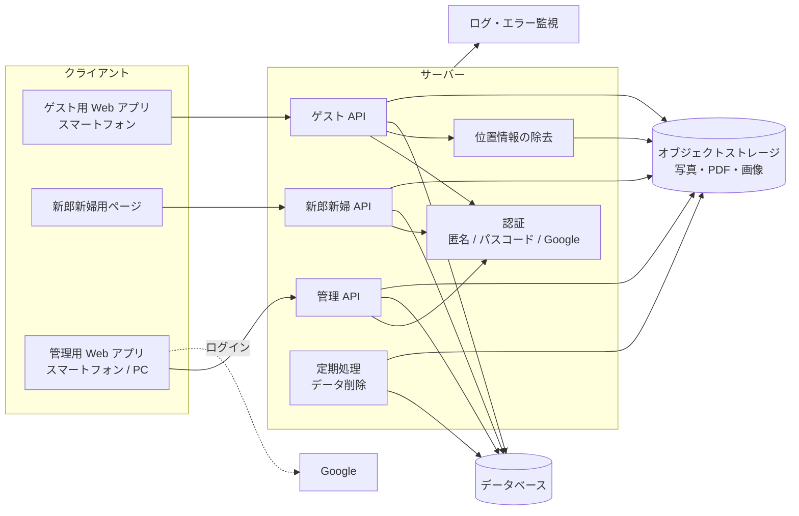
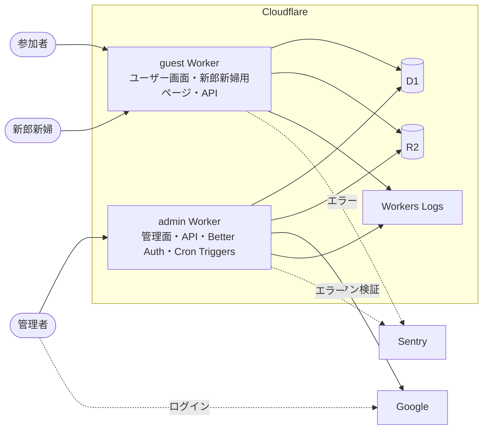
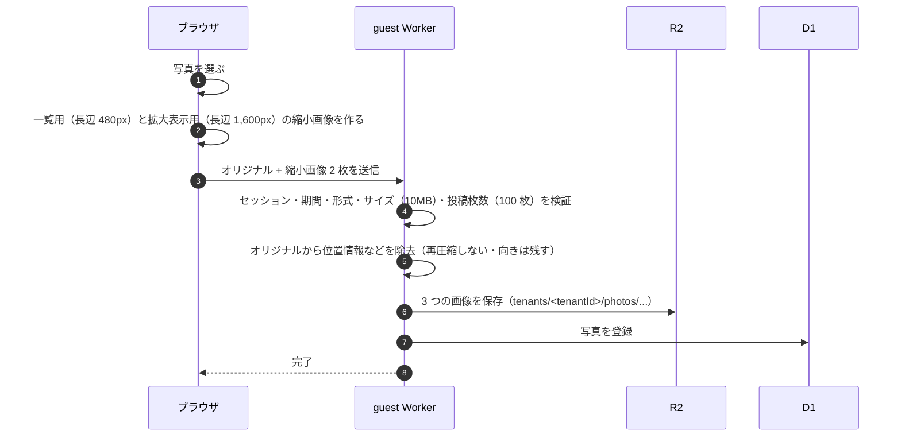

# アーキテクチャ

基盤は Cloudflare（Workers Paid プラン）とし、エラー監視に Sentry を併用する（D-32）。
採用した技術と選定理由は [ADR-0001](../adr/0001-select-tech-stack.md) に記録している（ステータス: 承認）。
本書では論理構成、物理構成、主な処理の方式をまとめる。
表とファイルの設計は [spec/database.md](../spec/database.md)、API は [spec/api.md](../spec/api.md)、期間の計算は [spec/tenant-periods.md](../spec/tenant-periods.md) に定める。

## 論理構成



| 構成要素 | 役割 | 関連 |
|---|---|---|
| ゲスト用 Web アプリ | 参加者向けの画面。スマートフォンのブラウザで動く。写真の縮小画像もここで作る | [screens.md](screens.md) |
| 新郎新婦用ページ | 新郎新婦向けの画面。ゲスト用と同じドメインで提供する | [screens.md](screens.md) |
| 管理用 Web アプリ | 管理面の画面。ゲスト用とは別のオリジンで提供する | [multi-tenancy.md](multi-tenancy.md) |
| ゲスト API | 参加、ニックネーム、写真、いいね、ランキング。すべてのリクエストでセッション・テナント・期間を検証する | [auth.md](auth.md) |
| 新郎新婦 API | 写真一覧、ランキング、絞り込み、保存。読み取り専用 | [auth.md](auth.md) |
| 管理 API | テナント、コンテンツ、URL の発行、写真の削除、ニックネームの変更、利用状況、プレビュー | FR-A-01〜FR-A-16 |
| 認証 | 参加者の匿名セッション、新郎新婦のパスコード照合、Google ログインと許可リストの照合 | [auth.md](auth.md) |
| 位置情報の除去 | アップロードされたオリジナル画像から、位置情報などのメタデータを取り除く | D-25 |
| 定期処理 | 開催日の 6 か月後にテナントのデータを削除する | FR-A-13 |
| データベース | テナント、参加者、写真のメタデータ、いいね、トークン、セッション | [domain-model.md](domain-model.md) |
| オブジェクトストレージ | 写真（オリジナル・拡大表示用・一覧用）、席次表 PDF、コース表画像。公開しない | [multi-tenancy.md](multi-tenancy.md) |
| ログ・エラー監視 | ログ・エラー率・応答時間・アラート。テナント ID で絞り込める | FR-A-09 |

## 物理構成



| Worker | ドメイン | 内容 |
|---|---|---|
| guest | `would-you-marry.me` | ユーザー画面と新郎新婦用ページ、それぞれの API |
| admin | `admin.would-you-marry.me` | 管理面の画面と API、Better Auth、Cron Triggers |

- ドメインは Workers Custom Domains で各 Worker に割り当てる
- 2 つの Worker は同じ D1 データベースと R2 バケットを使う
- Cookie にはドメイン属性を付けず、それぞれのホストだけに送られるようにする。ゲスト用と管理用でログイン状態を共有しない

### リポジトリ構成（案）

```
apps/
  guest/    # guest Worker（React + Hono）
  admin/    # admin Worker（React + Hono + Better Auth + Cron）
packages/
  db/       # Drizzle のスキーマとマイグレーション
  shared/   # 共通の型、期間の判定、ニックネームのルールなど
  ui/       # 画面部品とモーショングラフィックス（管理面のプレビューでも使う）
docs/
```

## 採用技術

選定理由は [ADR-0001](../adr/0001-select-tech-stack.md) を参照。

| 項目 | 採用 |
|---|---|
| 言語 | TypeScript |
| 画面 | React（Vite でビルドする SPA） |
| API | Hono |
| 実行環境・配信 | Cloudflare Workers（静的アセット配信、Cloudflare Vite プラグイン） |
| データベース | D1 + Drizzle ORM |
| ファイル保存 | R2（非公開バケット） |
| 管理者の認証 | Better Auth（Google ログインのみ） |
| 参加者・新郎新婦のセッション | 自前（HttpOnly Cookie + D1） |
| 席次表 PDF の表示 | PDF.js |
| 写真の保存 | Web Share API、使えない端末ではダウンロード |
| 定期処理 | Cron Triggers |
| ログ | Workers Logs |
| エラー監視 | Sentry |
| リポジトリ構成 | pnpm workspaces のモノレポ |
| ドメイン | Workers Custom Domains |
| デプロイ | Wrangler |

## 主な処理の方式

### 参加者・新郎新婦のセッション

- 128 ビット以上のランダムな値をセッション ID とし、HttpOnly・Secure・SameSite=Lax の Cookie に入れる
- D1 には、セッション ID のハッシュ値、テナント ID、種別（参加者 / 新郎新婦）、参加者 ID、有効期限を保存する
- Hono のミドルウェアで、リクエストごとに「セッションの有効性 → URL のテナント ID との一致 → テナントの期間と停止状態」を検証する
- 状態を変える API（アップロード、いいね、削除など）では Origin ヘッダーも確認する（CSRF 対策）

### 参加トークン・新郎新婦用トークン・パスコード

- トークンは 32 バイトの乱数（base64url）
- パスコードは Web Crypto の PBKDF2 でハッシュ化して保存する
- パスコードの失敗回数と最後に失敗した時刻を D1 に保存し、5 回続けて失敗したら 15 分間入力できなくする（仮置き）

### 管理者の認証

- Better Auth の Google プロバイダーだけを有効にする（メールアドレスとパスワードによるログインは使わない）
- 管理者を新しく登録するときと、リクエストごとに、メールアドレスが許可リスト（環境変数）にあるかを確認する。許可リストから外すと、すぐに管理面を使えなくなる

### 写真のアップロード



- 縮小画像はブラウザで JPEG として作る。ブラウザは描画時に写真の向きを反映するので、縮小画像は正しい向きになる
- オリジナルの JPEG は、EXIF のうち向き（Orientation）だけを残し、位置情報を含むその他の EXIF と XMP などのメタデータを取り除く
- 縮小画像のサイズ（480px・1,600px）は仮置き

### 写真・PDF・画像の配信

- すべて guest Worker（管理面の場合は admin Worker）を経由して R2 から返す。返す前にセッションとテナントを確認する
- 一覧には一覧用、拡大表示には拡大表示用の画像を使い、オリジナルは保存のときだけ返す（NFR-07）
- レスポンスはブラウザにだけキャッシュさせる（`Cache-Control: private`）

### ランキング

- 写真の表にいいね数（集計値）を持たせ、いいね・取り消しのたびに同じトランザクションで数え直す
- いいね数の多い順、同数なら投稿の古い順に並べ、いいね 0 件を除いて上位 10 件を返す（[spec/database.md](../spec/database.md#主なクエリ)）

### 自動削除

- Cron Triggers で 1 日 1 回、開催日の 6 か月後を過ぎたテナントを探す
- D1 からそのテナントの行を削除し、R2 の `tenants/<tenantId>/` 以下を削除する。テナント自体には削除した日時を記録する

### 期間の判定

- 開催日（日本時間）と現在時刻から、shared パッケージの関数でテナントの期間を求める。画面と API で同じ関数を使う

### 環境変数・シークレット

| 名前（案） | 内容 | Worker |
|---|---|---|
| `ADMIN_EMAILS` | 管理者の許可リスト（D-22） | admin |
| `BETTER_AUTH_SECRET` | Better Auth の署名用の秘密値 | admin |
| `GOOGLE_CLIENT_ID` / `GOOGLE_CLIENT_SECRET` | Google ログインの設定 | admin |
| `CONTACT_EMAIL` | 画面に表示する問い合わせ先（FR-G-15） | guest |
| `SENTRY_DSN` | Sentry の送信先 | guest / admin |

## デプロイ

すべて Wrangler（Cloudflare の CLI）で行う。

| 作業 | 方法 |
|---|---|
| Worker の設定 | 各 Worker の Wrangler 設定ファイルに、D1・R2 のバインディング、Custom Domains、Cron Triggers（admin のみ）、Workers Logs の有効化を書く |
| デプロイ | `apps/guest` と `apps/admin` で、それぞれ `wrangler deploy` を実行する |
| データベースのマイグレーション | Drizzle でマイグレーションの SQL を生成し、`wrangler d1 migrations apply` で適用する |
| シークレットの登録 | `wrangler secret put` で登録する（[環境変数・シークレット](#環境変数シークレット)） |
| ローカル開発 | Cloudflare Vite プラグインの開発サーバーで、D1・R2 をローカルで再現して動かす |

- Cron Triggers の時刻は UTC で指定する。日本時間の深夜（例: 3:00 = UTC 18:00）に 1 日 1 回実行する（仮置き）

## 決まっている前提

| 前提 | 内容 | 決定 |
|---|---|---|
| 基盤 | Cloudflare（Workers Paid プラン）。運用コストは制約にしない | D-32 |
| 期限 | 2026 年 10 月末の結婚式で使う。それまでに現在の要件をすべて作る | D-33 |
| 規模 | 1 テナント最大 200 名・写真 5,000 枚程度、同時に参加受付期間中のテナントは数件 | D-07 |
| 写真 | オリジナルのまま 1 枚ずつ、1 枚 10MB まで、1 人 100 枚まで。位置情報は取り除く | D-12, D-25, D-26 |
| 更新方式 | 再読み込みで反映。リアルタイム反映は不要 | D-24 |
| データ保持 | 開催日の 6 か月後に自動削除。手動削除もある。バックアップは取らない | D-19, D-30, D-31 |
| 管理者 | 許可リストは設定ファイル・環境変数で管理 | D-22 |

## 早めに検証すること

実装の最初に、次のことを実際の端末と環境で確かめる。

1. iPhone から写真をアップロードしたときのファイル形式（HEIC か JPEG か）。HEIC が届く場合の扱い（受け付けない / ブラウザで JPEG に変換する など）を決める
2. Worker で 10MB の JPEG から、再圧縮せずに位置情報を取り除けること。取り除いた後も写真の向きが正しいこと。CPU 時間とメモリの制限に収まること
3. PDF.js で、席次表 PDF をスマートフォンで拡大・スクロールして読めること
4. Web Share API で、iPhone・Android の写真アプリに保存できること
5. Better Auth の Google ログインが Workers + D1 で動くこと
6. LINE などのアプリ内ブラウザで、参加（Cookie の保存と再訪）・アップロード・保存が動くこと。動かない機能があれば、標準のブラウザで開くよう案内する（NFR-25）
