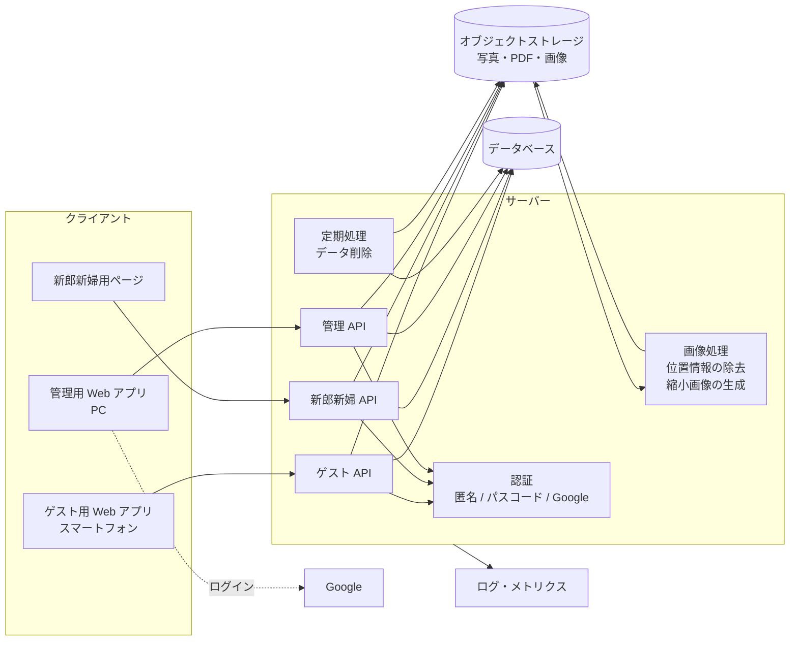

# アーキテクチャ

基盤は Cloudflare（Workers Paid プラン）とし、一部に他のサービスを併用する（D-32）。
本書では論理構成と、Cloudflare 上での構成要素ごとの候補を整理する。
具体的な選定と、併用するサービスの決定は [ADR-0001](../adr/README.md) として記録する。

## 論理構成

| 構成要素 | 役割 | 関連 |
|---|---|---|
| ゲスト用 Web アプリ | 参加者向けの画面。スマートフォンのブラウザで動く | [screens.md](screens.md) |
| 新郎新婦用ページ | 新郎新婦向けの画面。ゲスト用と同じドメインで提供する（仮置き） | [screens.md](screens.md) |
| 管理用 Web アプリ | 管理面の画面。ゲスト用とは別のオリジンで提供する | [multi-tenancy.md](multi-tenancy.md) |
| ゲスト API | 参加、ニックネーム、写真、いいね、ランキング。すべてのリクエストでセッション・テナント・期間を検証する | [auth.md](auth.md) |
| 新郎新婦 API | 写真一覧、ランキング、絞り込み、保存。読み取り専用 | [auth.md](auth.md) |
| 管理 API | テナント、コンテンツ、URL の発行、写真の削除、ニックネームの変更、利用状況、プレビュー | FR-A-01〜FR-A-16 |
| 認証 | 参加者の匿名セッション、新郎新婦のパスコード照合、Google 認証と許可リストの照合 | [auth.md](auth.md) |
| 画像処理 | アップロードされた写真から位置情報などを取り除き、縮小画像を作る | D-25, NFR-07 |
| 定期処理 | 開催日の 6 か月後にテナントのデータを削除する | FR-A-13 |
| データベース | テナント、参加者、写真のメタデータ、いいね、トークン | [domain-model.md](domain-model.md) |
| オブジェクトストレージ | 写真（オリジナル・縮小画像）、席次表 PDF、コース表画像。公開しない | [multi-tenancy.md](multi-tenancy.md) |
| ログ・メトリクス | ログ・エラー率・応答時間・アラート。テナント ID で絞り込める | FR-A-09 |

## 技術選定

### 決まっている前提

| 前提 | 内容 | 決定 |
|---|---|---|
| 基盤 | Cloudflare（Workers Paid プラン）。一部に他のサービスを併用する。運用コストは制約にしない | D-32 |
| 期限 | 2026 年 10 月末の結婚式で使う。それまでに現在の要件をすべて作る | D-33 |
| 規模 | 1 テナント最大 200 名・写真 5,000 枚程度、同時に参加受付期間中のテナントは数件 | D-07 |
| 写真 | オリジナルのまま 1 枚ずつ、1 枚 10MB まで、1 人 100 枚まで。位置情報は取り除く | D-12, D-25, D-26 |
| 更新方式 | 再読み込みで反映。リアルタイム反映は不要 | D-24 |
| データ保持 | 開催日の 6 か月後に自動削除。手動削除もある。バックアップは取らない | D-19, D-30, D-31 |
| 管理者 | 許可リストは設定ファイル・環境変数で管理 | D-22 |

### 構成要素ごとの候補

| 構成要素 | 候補 | 補足 |
|---|---|---|
| Web アプリ（ゲスト・新郎新婦・管理） | Workers（静的アセット配信を含む） | ゲスト用と管理用はオリジンを分ける |
| API | Workers | — |
| データベース | D1 | SQLite ベース。ランキングなどの集計を SQL で書ける。テナント分離はアプリケーション層（クエリの共通部分）で強制する |
| 写真・PDF・画像の保存 | R2 | 転送量の課金がない。非公開にし、Worker 経由か署名付き URL で配信する |
| 参加者・新郎新婦のセッション | Worker で発行する署名付き Cookie（HttpOnly） / KV / D1 / 外部の認証サービス（例: Firebase Authentication の匿名認証） | 参加トークンとパスコードの検証は、どの案でも自前で実装する |
| 管理者の認証 | Cloudflare Access（Google をログイン方法にし、許可するメールアドレスをポリシーで指定） / Worker で Google ログインを実装 / 外部の認証サービス | Access なら、管理面の手前で認証が済み、許可リストを Access のポリシーとして管理できる |
| 縮小画像の生成・位置情報の除去 | アップロード前にブラウザ側で処理 / Worker 内で処理（WebAssembly の画像ライブラリ） / Cloudflare Images の画像変換 / 外部のサービス | オリジナル画質を保ったまま位置情報だけを除くには、再圧縮せずにメタデータを取り除く処理が必要 |
| 定期処理（自動削除） | Cron Triggers | — |
| 試行回数の制限（パスコード、参加など） | Durable Objects / KV / D1 / Workers のレート制限機能 | — |
| ログ・メトリクス | Workers Logs / Logpush / Workers Analytics Engine / 外部の監視サービス | ログにテナント ID を含める |

### 技術選定後に確認すること

- iPhone の写真は HEIC 形式のことがある。ブラウザからアップロードしたときの実際の形式、縮小画像を多くのブラウザで表示できる形式で作れるか、オリジナルの HEIC を Android などで保存したときに開けるかを確認する
- 位置情報などのメタデータを、画質を落とさずに取り除けるか（再圧縮せずにメタデータだけを消せるか）
- メタデータを取り除くときに画像の向き（Orientation）の情報まで消すと、写真が横倒しで表示される。向きの情報は残すか、画素に反映してから消す
- 10MB の写真を Worker で受け取るか、R2 へ直接アップロードさせるか。Worker で画像処理する場合は、CPU 時間とメモリの制限に収まるか

### 進め方

1. 構成要素ごとに候補を選び、併用する他のサービスとあわせて [ADR-0001](../adr/README.md) に記録する
2. 本書を具体的な構成に更新し、API 仕様・物理スキーマを作成する
