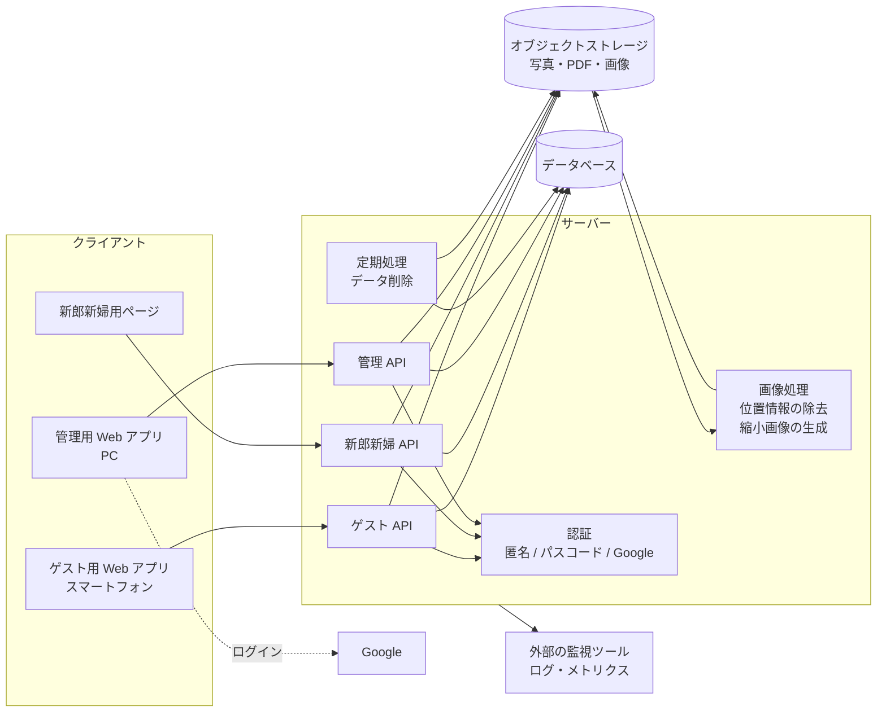

# アーキテクチャ

技術スタックは未選定（D-01）。
本書では技術に依存しない論理構成と、技術選定の前提・評価軸・候補を整理する。
選定の結論は [ADR-0001](../adr/README.md) として記録する。

## 論理構成

| 構成要素 | 役割 | 関連 |
|---|---|---|
| ゲスト用 Web アプリ | 参加者向けの画面。スマートフォンのブラウザで動く | [screens.md](screens.md) |
| 新郎新婦用ページ | 新郎新婦向けの画面。ゲスト用と同じドメインで提供する（仮置き） | [screens.md](screens.md) |
| 管理用 Web アプリ | 管理面の画面。ゲスト用とは別のオリジンで提供する | [multi-tenancy.md](multi-tenancy.md) |
| ゲスト API | 参加、ニックネーム、写真、いいね、ランキング。すべてのリクエストでセッション・テナント・期間を検証する | [auth.md](auth.md) |
| 新郎新婦 API | 写真一覧、ランキング、絞り込み、保存。読み取り専用 | [auth.md](auth.md) |
| 管理 API | テナント、コンテンツ、URL の発行、写真の削除、利用状況 | FR-A-01〜FR-A-13 |
| 認証 | 参加者の匿名セッション、新郎新婦のパスコード照合、Google 認証と許可リストの照合 | [auth.md](auth.md) |
| 画像処理 | アップロードされた写真から位置情報などを取り除き、縮小画像を作る | D-25, NFR-07 |
| 定期処理 | 開催日の 6 か月後にテナントのデータを削除する | FR-A-13 |
| データベース | テナント、参加者、写真のメタデータ、いいね、トークン | [domain-model.md](domain-model.md) |
| オブジェクトストレージ | 写真（オリジナル・縮小画像）、席次表 PDF、コース表画像。公開しない | [multi-tenancy.md](multi-tenancy.md) |
| 外部の監視ツール | ログ・エラー率・応答時間・アラート。テナント ID で絞り込める | FR-A-09 |

## 技術選定

### 決まっている前提

| 前提 | 内容 | 決定 |
|---|---|---|
| 規模 | 1 テナント最大 200 名・写真 5,000 枚程度、同時に参加受付期間中のテナントは数件 | D-07 |
| 写真 | オリジナルのまま 1 枚ずつ、1 枚 10MB まで。位置情報はサーバー側で取り除く | D-12, D-25 |
| 更新方式 | 再読み込みで反映。リアルタイム反映は不要 | D-24 |
| データ保持 | 開催日の 6 か月後に自動削除 | D-19 |
| 監視 | 詳細なログ・メトリクスは外部の監視ツールを使う | D-20 |
| 管理者 | 許可リストは設定ファイル・環境変数 | D-22 |

### 評価軸

| 評価軸 | 理由 |
|---|---|
| 匿名認証と参加トークンの検証 | 参加の仕組みの中心（FR-G-01, FR-G-02） |
| パスコード認証 | 新郎新婦用ページ（FR-C-01）。一般的な認証機能ではなく独自の仕組みが必要 |
| Google 認証と許可リスト | 管理面のログイン（FR-A-01） |
| テナント分離をどこで強制できるか | 他テナントへのアクセスを防ぐ（[multi-tenancy.md](multi-tenancy.md) の P3） |
| 写真の保存・非公開配信・画像処理 | 位置情報の除去と縮小画像の生成（FR-G-07, NFR-07, NFR-16） |
| ランキングの集計 | FR-G-12 |
| 定期処理 | データの自動削除（FR-A-13） |
| 当日のアクセス集中への耐性 | NFR-08 |
| 運用の手間とコスト | 個人で運用する規模（D-07）、NFR-20 |
| ロックインの度合い | 将来の移行のしやすさ |

### 候補

| 観点 | A. Firebase 中心 | B. Supabase 中心 | C. 自前のバックエンド |
|---|---|---|---|
| 構成の例 | Firebase Authentication、Cloud Firestore、Cloud Storage for Firebase、Cloud Functions | Supabase Auth、Postgres、Supabase Storage、Edge Functions | 任意の Web フレームワーク、PostgreSQL など、S3 / GCS など |
| 匿名認証 | 標準機能あり | 標準機能あり | 自分で実装する |
| 参加トークンの検証 | 匿名サインインだけでは誰でも参加できるため、サーバー側の処理でトークンを検証してテナントを紐づける仕組みが別途必要 | 同左（サーバー側の処理や DB の関数で検証する） | 参加処理の中で自然に実装できる |
| パスコード認証 | 独自に実装する（サーバー側の処理でカスタムトークンを発行するなど） | 独自に実装する | 自分で実装する |
| Google 認証 | 標準機能あり | 標準機能あり | OpenID Connect のライブラリなどで実装する |
| セッションの保存先 | SDK がブラウザのストレージに保存する | SDK の既定はブラウザのストレージ（Cookie も使える） | 自由に選べる（HttpOnly Cookie など） |
| テナント分離の強制 | Security Rules でテナント ID を検証する | Row Level Security で DB 層で強制する | アプリケーション層で強制する（DB の機能と併用も可） |
| ファイルの非公開配信 | Storage の Security Rules | Storage のポリシー、署名付き URL | 署名付き URL |
| 画像処理 | Cloud Functions（Storage へのアップロードをきっかけに実行） | Edge Functions など（実行環境で使える画像処理ライブラリを要確認） | 任意のライブラリ |
| ランキングの集計 | いいね数のカウンタを持ち、整合性を保って更新する設計が必要 | SQL で集計しやすい | SQL で集計しやすい |
| 定期処理 | Cloud Scheduler と Cloud Functions など | Supabase Cron など | cron など |
| 運用の手間 | 少ない（マネージド） | 少ない（マネージド） | 多い |
| ロックイン | 強め | 中程度（Postgres ベース、セルフホストも可） | 弱い |

リアルタイム反映は不要になった（D-24）ため、A・B の強みの 1 つは評価から外れる。

### 技術選定後に確認すること

- iPhone の写真は HEIC 形式のことがある。ブラウザからアップロードしたときの実際の形式、縮小画像を多くのブラウザで表示できる形式で作れるか、オリジナルの HEIC を Android などで保存したときに開けるかを確認する
- 位置情報などのメタデータを、画質を落とさずに取り除けるか（再圧縮せずにメタデータだけを消せるか）

### 進め方

1. 上の評価軸で候補を比べ、[ADR-0001](../adr/README.md) に結論を記録する
2. 選定後、本書を具体的な構成に更新し、API 仕様・物理スキーマを作成する
