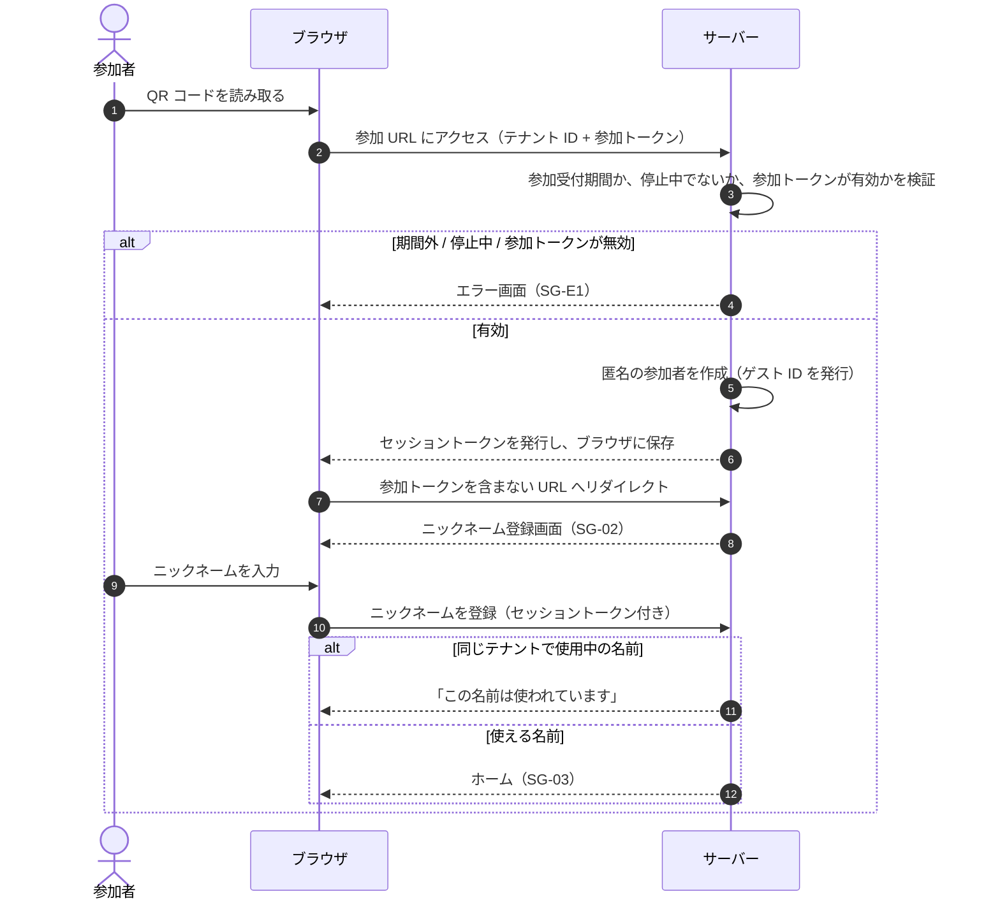
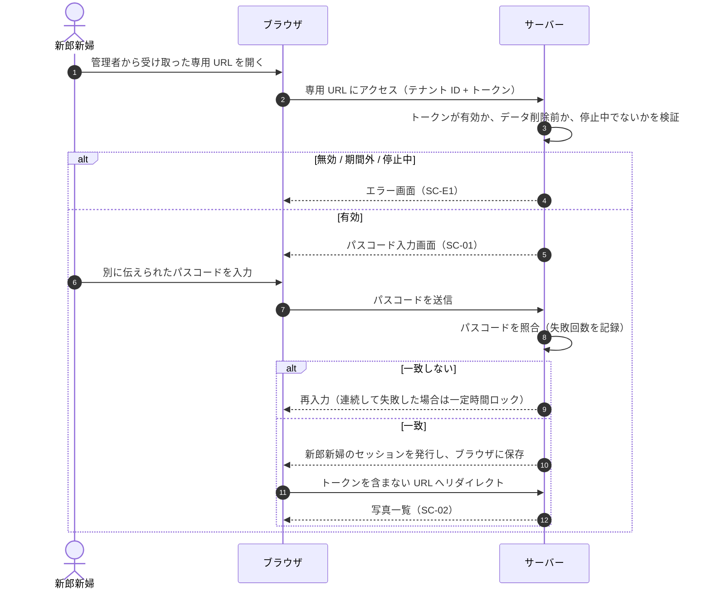
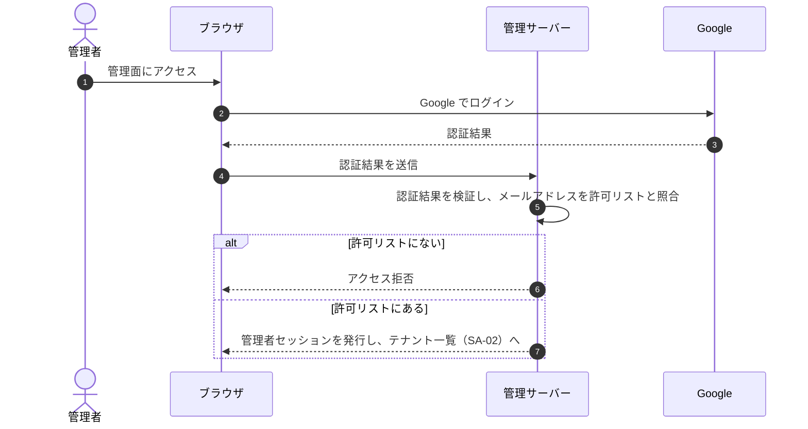

# 認証・認可

## 方針

| 対象 | 方式 | 識別するもの | セッション |
|---|---|---|---|
| 参加者 | 匿名認証（参加 URL の参加トークンで参加を許可） | ゲスト ID | ブラウザに保存。1 つのテナントにだけ有効。閲覧期間の終わり（開催日の 3 か月後）まで |
| 新郎新婦 | 専用 URL + パスコード | テナント（新郎新婦として） | ブラウザに保存。1 つのテナントにだけ有効。データ削除（開催日の 6 か月後）まで |
| 管理者 | Google 認証 + 許可リスト | メールアドレス | 管理者セッション。参加者・新郎新婦のセッションとは別に管理する |

関連する決定: 参加者は匿名認証のみ（D-02）、管理者は Google 認証（D-03）、QR コードはテナント共通（D-04）、新郎新婦用ページ（D-18）、許可リストは設定で管理（D-22）。

---

## 参加者の認証

### 参加 URL（テナント共通 QR）

- 1 テナントにつき 1 つの参加 URL を発行し、QR コードにして受付で配布する（FR-A-07）
- 参加 URL にはテナント ID と参加トークンを含める（URL の形式は [multi-tenancy.md](multi-tenancy.md#url-の形式仮置き)）
- 参加トークンは十分な長さの暗号学的に安全な乱数とし、推測できないようにする
- 参加トークンで参加できるのは参加受付期間（開催日当日〜翌日）だけ（D-08）

### 参加の流れ

### 再訪時

- そのテナントの有効なセッションがブラウザにあれば、参加 URL にアクセスしても新しい参加者は作らない（FR-G-02）
  - ニックネーム登録済みならホーム、未登録ならニックネーム登録画面に進む
- 同じブラウザで別のテナント（別の結婚式）に参加した場合は、そのテナントの参加者として別に扱う

### セッショントークン

- 利用者を識別するために、ブラウザに保存する
- 1 つのテナントにだけ有効。サーバーはリクエストごとに、セッションのテナントと操作対象のテナントが一致するかを検証する（[multi-tenancy.md](multi-tenancy.md)）
- リクエストごとに、テナントの期間と停止状態も確認する
- 参加者のセッションは閲覧期間の終わり（開催日の 3 か月後）まで有効。参加 URL を再発行しても無効にしない（D-08）
- JavaScript から読み出せない保存方法（HttpOnly Cookie など）が望ましい。採用する技術によって選べる方法が変わるため、技術選定時に決める（[architecture.md](architecture.md)）

### 参加 URL の流出対策

テナント共通 QR 方式では、参加 URL を知っている人なら誰でも参加できる。
QR コードの写真が SNS に投稿されたり、参加者が URL を転送したりすると、部外者が参加できてしまう。

| 対策 | 内容 | 関連 |
|---|---|---|
| 有効期間 | 参加トークンは参加受付期間（開催日当日〜翌日）だけ有効 | D-08 |
| 再発行 | 管理面で再発行すると、古い参加トークンは無効になる | FR-A-08 |
| URL からの除去 | 検証後にリダイレクトし、参加トークンをアドレスバーや履歴に残さない。参加者が画面の URL を共有しても参加トークンは漏れない | FR-G-01 |
| 検知 | 管理面の利用状況（参加者数）で、想定外の増加に気付けるようにする | FR-A-10 |

受け入れるリスク:

- 参加受付期間中に参加 URL を知った部外者は参加できる。参加者ごとの個別 QR 方式と比べたときの弱点であり、手軽さとの引き換えとして受け入れる
- 再発行しても、すでに参加した部外者のセッションは無効にならない（D-08）。不適切な投稿は管理者が削除して対応する（FR-A-11）

### セッションを失った場合

ブラウザのデータを削除した場合や、別のブラウザ・端末で開いた場合は、セッションを引き継げない（D-09）。

- 参加受付期間中なら、QR コードを読み直して新しい参加者として参加する
- それまでに投稿した写真はアルバムに残るが、自分の写真として削除することはできなくなる
- 元のニックネームは使用中のため、別のニックネームで登録する（D-10）
- 参加受付期間が終わった後は、新しく参加できない

---

## 新郎新婦の認証

### 専用 URL とパスコード

- 管理者が、1 テナントにつき 1 つの専用 URL とパスコードを発行する（FR-A-12）
- 専用 URL にはテナント ID と推測困難なトークンを含める。パスコードはシステムが生成する（仮置き: 英数字 8 文字）
- 管理者は専用 URL とパスコードを別々の手段で二人に伝える（仮置き）。URL だけが漏れても入れないようにするため
- パスコードはハッシュ値だけを保存し、平文は発行時に一度だけ表示する（仮置き）

### 入場の流れ

- パスコードを連続して間違えた場合は、しばらく入力できなくする（仮置き: 5 回失敗で 15 分）
- 新郎新婦のセッションはデータ削除（開催日の 6 か月後）まで有効（仮置き）
- 再発行すると、古い URL・パスコードと、既存の新郎新婦のセッションを無効にする（仮置き）。新郎新婦は 2 人だけなので、渡し直す負担が小さいため

---

## 管理者の認証

- メールアドレスが確認済みの Google アカウントだけを受け付ける
- 許可リストは設定ファイル・環境変数で管理する。変更するときは設定を更新してデプロイする（D-22）
- 管理面と、ユーザー画面・新郎新婦用ページのセッションは別に管理する。管理者のセッションでユーザー画面を操作することはできず、参加者・新郎新婦のセッションで管理面を操作することもできない

---

## 認可

○: できる / ×: できない / —: 対象外

| 操作 | 未参加 | 参加者（ニックネーム未登録） | 参加者（登録済み） | 新郎新婦 | 管理者 |
|---|---|---|---|---|---|
| 参加 URL から参加する | ○（参加受付期間のみ） | — | — | — | — |
| ニックネームを登録・変更する | × | ○（登録） | ○（変更） | — | — |
| ホーム・席次表・コース表を見る | × | × | ○ | — | — |
| 写真をアップロードする | × | × | ○ | × | × |
| 写真を閲覧・保存する | × | × | ○ | ○ | ○（閲覧のみ） |
| いいねする・取り消す | × | × | ○ | × | × |
| いいね数・ランキングを見る | × | × | ○ | ○ | ○ |
| 投稿者で絞り込む | × | × | × | ○ | × |
| 写真を削除する | × | × | ○（自分の写真のみ） | × | ○ |
| テナントを作成・設定・停止する | × | × | × | × | ○ |
| 参加 URL・新郎新婦用 URL を発行する | × | × | × | × | ○ |
| 利用状況を見る | × | × | × | × | ○ |

- 参加者・新郎新婦の操作は、自分のテナントのデータだけが対象
- 参加者の操作は閲覧期間の終わり（開催日の 3 か月後）まで、新郎新婦の操作はデータ削除（開催日の 6 か月後）まで
- テナントが停止中の間は、参加者・新郎新婦とも何もできない
- 管理者はすべてのテナントを操作できる
