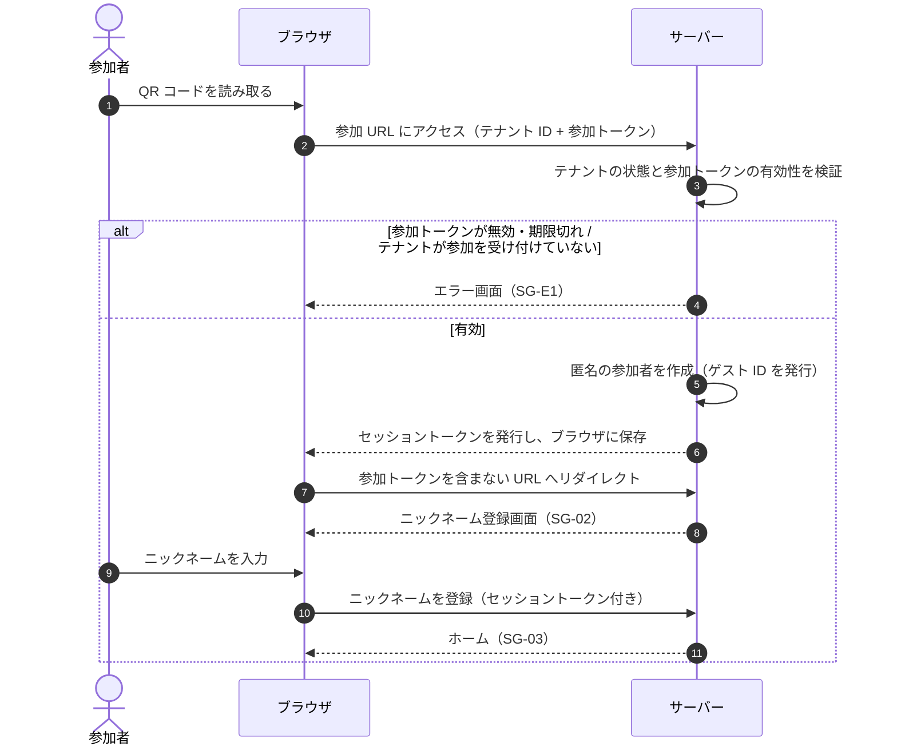
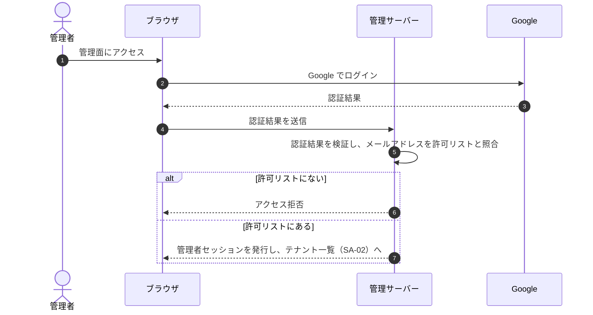

# 認証・認可

## 方針

| 対象 | 方式 | 識別するもの | セッション |
|---|---|---|---|
| 参加者 | 匿名認証（参加 URL の参加トークンで参加を許可） | ゲスト ID | セッショントークン。ブラウザに保存し、1 つのテナントにだけ有効 |
| 管理者 | Google 認証 + 許可リスト | メールアドレス | 管理者セッション。参加者のセッションとは別に管理する |

決定済みの事項: 参加者は匿名認証のみ（[D-02](../open-questions.md)）、管理者は Google 認証（[D-03](../open-questions.md)）、QR コードはテナント共通（[D-04](../open-questions.md)）。

---

## 参加者の認証

### 参加 URL（テナント共通 QR）

- 1 テナントにつき 1 つの参加 URL を発行し、QR コードにして受付で配布する（FR-A-07）
- 参加 URL にはテナント ID と参加トークンを含める（URL の形式は [multi-tenancy.md](multi-tenancy.md#url-の形式仮置き)）
- 参加トークンは十分な長さの暗号学的に安全な乱数とし、推測できないようにする

### 参加の流れ

### 再訪時

- そのテナントの有効なセッションがブラウザにあれば、参加 URL にアクセスしても新しい参加者は作らない（FR-G-02）
  - ニックネーム登録済みならホーム、未登録ならニックネーム登録画面に進む
- 同じブラウザで別のテナント（別の結婚式）に参加した場合は、そのテナントの参加者として別に扱う

### セッショントークン

- 参加者を識別するために、ブラウザに保存する
- 1 つのテナントにだけ有効。サーバーはリクエストごとにセッションのテナントと操作対象のテナントが一致するかを検証する（[multi-tenancy.md](multi-tenancy.md)）
- JavaScript から読み出せない保存方法（HttpOnly Cookie など）が望ましい。採用する技術によって選べる方法が変わるため、技術選定時に決める（[architecture.md](architecture.md)）
- 有効期間は [OQ-02](../open-questions.md)

### 参加 URL の流出対策

テナント共通 QR 方式では、参加 URL を知っている人なら誰でも参加できる。
QR コードの写真が SNS に投稿されたり、参加者が URL を転送したりすると、部外者が参加できてしまう。

| 対策 | 内容 | 関連 |
|---|---|---|
| 有効期間 | 参加トークンは開催日の前後など限られた期間だけ有効にする | FR-A-07、[OQ-02](../open-questions.md) |
| 再発行 | 管理面で再発行すると、古い参加トークンは無効になる | FR-A-08 |
| URL からの除去 | 検証後にリダイレクトし、参加トークンをアドレスバーや履歴に残さない。参加者が画面の URL を共有しても参加トークンは漏れない | FR-G-01 |
| 検知 | 参加者数のメトリクスで、想定外の増加に気付けるようにする | FR-A-10 |

受け入れるリスク: 有効期間中に参加 URL を知った部外者は参加できる。これは参加者ごとの個別 QR 方式と比べたときの弱点であり、手軽さとの引き換えとして受け入れる。

### セッションを失った場合

ブラウザのデータを削除した場合や、別のブラウザ・端末で開いた場合は、セッションを引き継げない。
QR コードを読み直すと新しい参加者として参加することになり、それまでに投稿した写真やいいねとの紐付けは失われる（仮置き）。
引き継ぎの手段を用意するかは [OQ-03](../open-questions.md)。

---

## 管理者の認証

- メールアドレスが確認済みの Google アカウントだけを受け付ける
- 許可リストは AdminUser として管理する（[domain-model.md](domain-model.md)）。最初の管理者の登録方法と追加・削除の方法は [OQ-16](../open-questions.md)
- 管理面とユーザー画面のセッションは別に管理する。管理者のセッションでユーザー画面を操作することはできず、参加者のセッションで管理面を操作することもできない（仮置き）

---

## 認可

○: できる / ×: できない / —: 対象外

| 操作 | 未参加 | 参加者（ニックネーム未登録） | 参加者（登録済み） | 管理者 |
|---|---|---|---|---|
| 参加 URL から参加する | ○ | — | — | — |
| ニックネームを登録する | × | ○ | 変更は [OQ-04](../open-questions.md) | — |
| ホーム・席次表・コース表を見る | × | × | ○（自分のテナントのみ） | — |
| 写真をアップロードする | × | × | ○（自分のテナントのみ） | — |
| 写真を閲覧・保存する | × | × | ○（自分のテナントのみ） | — |
| いいねする | × | × | ○（自分のテナントの写真のみ） | — |
| 写真を削除する | × | × | [OQ-07](../open-questions.md) | [OQ-08](../open-questions.md) |
| テナントを作成・設定する | × | × | × | ○（全テナント） |
| 参加 URL を発行・再発行する | × | × | × | ○（全テナント） |
| ログ・メトリクスを見る | × | × | × | ○（全テナント） |
