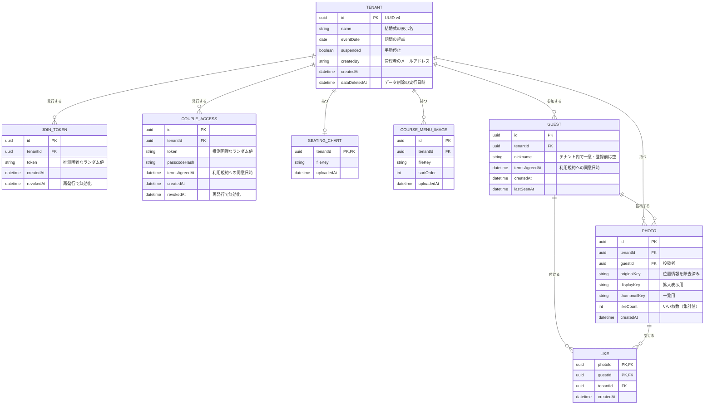

# ドメインモデル

論理モデル。物理的なスキーマ（テーブル・コレクション設計、型、インデックス）は技術選定後に定める。

## エンティティ

| エンティティ | 説明 | テナントスコープ | 主な属性 |
|---|---|---|---|
| Tenant | 1 つの結婚式 | — | ID（UUID）、テナント名、開催日、停止中かどうか |
| JoinToken | 参加 URL に含まれる参加トークン | あり | トークン値、無効化日時 |
| CoupleAccess | 新郎新婦用 URL のトークンとパスコード | あり | トークン値、パスコードのハッシュ値、無効化日時 |
| SeatingChart | 席次表 PDF | あり | ファイルの保存先、登録日時 |
| CourseMenuImage | 料理のコース表の画像 | あり | ファイルの保存先、表示順 |
| Guest | 匿名認証で参加した参加者 | あり | ID、ニックネーム |
| Photo | 参加者が投稿した写真 | あり | 投稿者、オリジナル画像・拡大表示用画像・一覧用画像の保存先、投稿日時 |
| Like | 写真へのいいね | あり | 写真、いいねした参加者 |

管理者の許可リストは設定ファイル・環境変数で管理する（D-22）。管理者のアカウントとログイン状態は、認証ライブラリが管理する表に保存する（[ADR-0001](../adr/0001-select-tech-stack.md)）。
参加者・新郎新婦のセッションもデータベースに保存するが、実装上の都合なので本書の論理モデルには含めない（[architecture.md](architecture.md)）。

## 関係

## 主な制約・ルール

- **Tenant**:
  - ID は UUID v4 をシステムが採番する（[multi-tenancy.md](multi-tenancy.md)）
  - 現在の期間は保存せず、開催日と現在日時から求める（[テナントの期間](../overview.md#テナントの期間)）。停止中かどうかだけを保存する
- **JoinToken**: 1 テナントで同時に有効なトークンは 1 つまで。再発行すると古いトークンに無効化日時を記録する（FR-A-08）。有効期間は開催日から求める（D-08）
- **CoupleAccess**:
  - 1 テナントで同時に有効なものは 1 つまで
  - パスコードはハッシュ値だけを保存する。平文は発行時に一度だけ表示する（仮置き）
- **Guest**:
  - 1 つのブラウザのセッションが 1 人の Guest に対応する
  - 同じ人が別の結婚式に参加しても、テナントごとに別の Guest として扱う
  - ニックネームは登録前は空。登録後は同じテナント内で一意（D-10）。管理者も変更できる（FR-A-16）
  - 利用規約への同意日時を記録する（FR-G-14）
- **Photo**:
  - 投稿者の Guest と同じテナントに属する
  - オリジナル画像は位置情報などのメタデータを取り除いてから保存する（D-25）
  - 投稿者本人（FR-G-13）か管理者（FR-A-11）が削除できる。削除すると、その写真の Like とファイルも削除する
- **Like**:
  - (photoId, guestId) の組で一意。1 人の参加者が同じ写真にいいねできるのは 1 回まで。自分の写真にも付けられる（D-15）
  - いいねの取り消しは Like の削除で表す
  - Photo と Guest は同じテナントに属していなければならない
  - Photo にいいね数（集計値）を持たせ、いいね・取り消しのたびに Like の件数から数え直す（[spec/database.md](../spec/database.md)）
- **データ削除**: 開催日の 6 か月後に、テナントに属するすべてのエンティティとファイルを削除する。Tenant 自体は残し、`dataDeletedAt` を記録する（FR-A-13）。管理者による手動削除（FR-A-15）も同じ。バックアップは取らないため、削除したデータは復元できない（D-31, NFR-22）

## テナントスコープ

Tenant 以外のエンティティはすべて `tenantId` を持つ。
テナントスコープのデータを読み書きするときは、必ず `tenantId` で絞り込む（[multi-tenancy.md](multi-tenancy.md)）。
