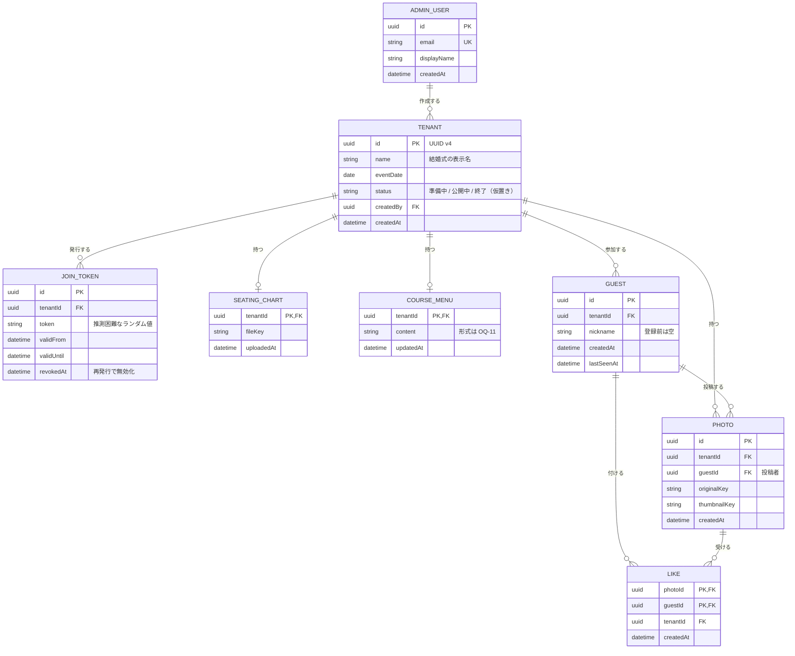

# ドメインモデル

論理モデル。物理的なスキーマ（テーブル・コレクション設計、型、インデックス）は技術選定後に定める。

## エンティティ

| エンティティ | 説明 | テナントスコープ | 主な属性 |
|---|---|---|---|
| AdminUser | 管理者。許可リストの各エントリに相当する | なし（全テナント共通） | メールアドレス、表示名 |
| Tenant | 1 つの結婚式 | — | ID（UUID）、テナント名、開催日、状態 |
| JoinToken | 参加 URL に含まれる参加トークン | あり | トークン値、有効期間、無効化日時 |
| SeatingChart | 席次表 PDF | あり | ファイルの保存先、登録日時 |
| CourseMenu | 料理のコース表 | あり | 内容（形式は [OQ-11](../open-questions.md)） |
| Guest | 匿名認証で参加した参加者 | あり | ID、ニックネーム |
| Photo | 参加者が投稿した写真 | あり | 投稿者、オリジナル画像と縮小画像の保存先、投稿日時 |
| Like | 写真へのいいね | あり | 写真、いいねした参加者 |

## 関係

## 主な制約・ルール

- **Tenant**: ID は UUID v4 をシステムが採番する（[multi-tenancy.md](multi-tenancy.md)）
- **JoinToken**: 1 テナントで同時に有効なトークンは 1 つまで。再発行すると古いトークンに無効化日時を記録する（FR-A-08）
- **Guest**:
  - 1 つのブラウザのセッションが 1 人の Guest に対応する
  - 同じ人が別の結婚式に参加しても、テナントごとに別の Guest として扱う
  - ニックネームは登録前は空。空の Guest はホーム以降を使えない（FR-G-03）
- **Photo**: 投稿者の Guest と同じテナントに属する
- **Like**:
  - (photoId, guestId) の組で一意。1 人の参加者が同じ写真にいいねできるのは 1 回まで（FR-G-10）
  - Photo と Guest は同じテナントに属していなければならない
  - いいね数は Like の件数から求める。表示用の集計値を Photo に持たせるかは技術選定時に決める
- **削除**: 写真の削除（[OQ-07](../open-questions.md)、[OQ-08](../open-questions.md)）とテナント終了後のデータ削除（[OQ-13](../open-questions.md)）が決まったら、削除時の関連データの扱いを追記する

## テナントスコープ

AdminUser 以外のエンティティはすべて `tenantId` を持つ（Tenant 自身は `id`）。
テナントスコープのデータを読み書きするときは、必ず `tenantId` で絞り込む（[multi-tenancy.md](multi-tenancy.md)）。
