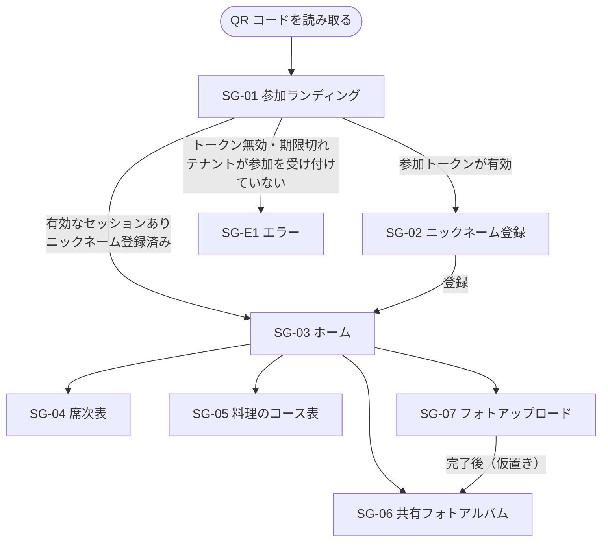
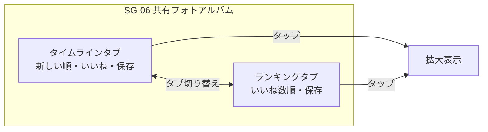
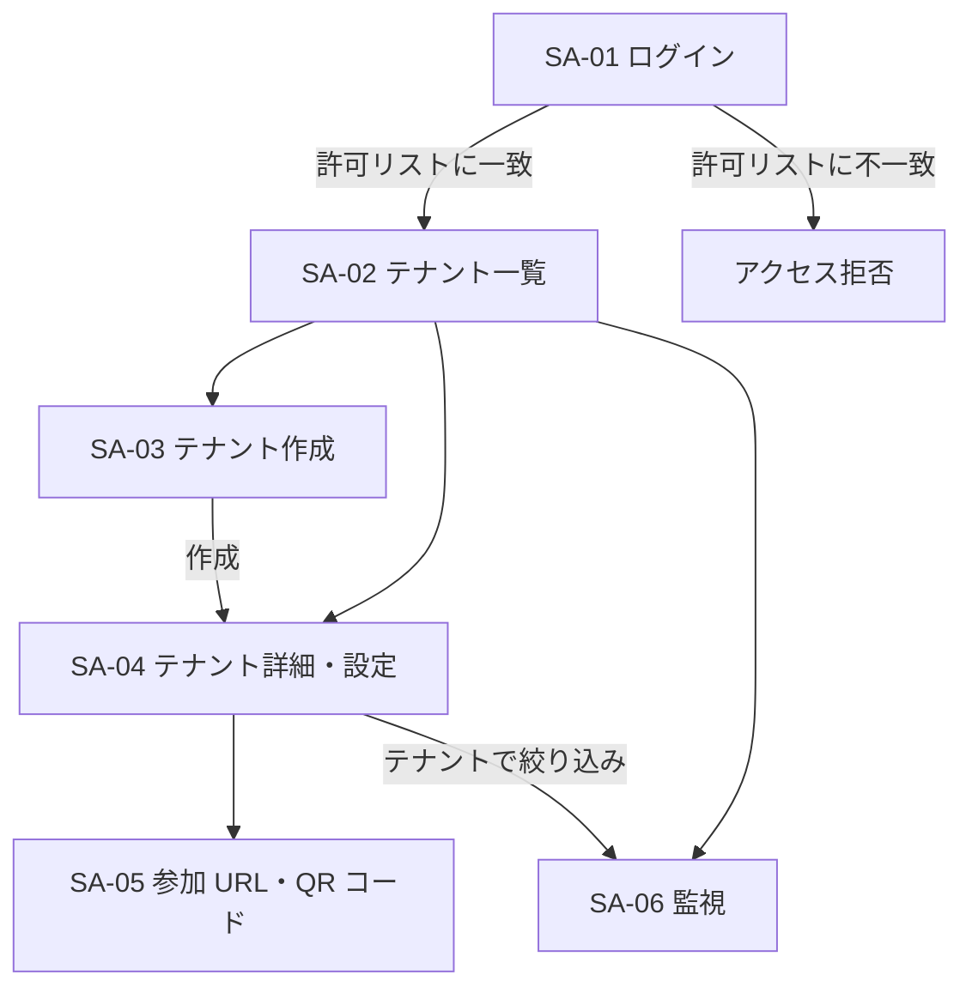

# 画面一覧・画面遷移

画面の構成要素は仮置き。レイアウトやデザインは別途決める。

## ユーザー画面

| ID | 画面 | 概要 | 主な要素 | 機能要件 |
|---|---|---|---|---|
| SG-01 | 参加ランディング | QR コードの遷移先。参加トークンを検証してセッションを発行する | 処理中の表示 | FR-G-01, FR-G-02 |
| SG-02 | ニックネーム登録 | 初回のみ表示する | ニックネーム入力欄、登録ボタン | FR-G-03 |
| SG-03 | ホーム | 各ページへの入口 | テナント名、4 ページへのリンク | FR-G-04 |
| SG-04 | 席次表 | 席次表 PDF をインライン表示する | PDF ビューア | FR-G-05 |
| SG-05 | 料理のコース表 | コース内容を表示する | コース内容 | FR-G-06 |
| SG-06 | 共有フォトアルバム | 写真の一覧。タイムラインとランキングの 2 タブ | タブ、写真の一覧、いいねボタン、保存ボタン、拡大表示 | FR-G-08〜FR-G-12 |
| SG-07 | フォトアップロード | 写真を選んで投稿する | 写真の選択、アップロードボタン、進捗・結果の表示 | FR-G-07 |
| SG-E1 | エラー | 参加できない・セッションがない場合 | エラーの内容と、受付の QR コードを読み取るよう促すメッセージ | FR-G-01 |

共通（仮置き）:

- SG-03 以外の画面からホームに戻れる
- セッションがない状態でユーザー画面のページにアクセスした場合は SG-E1 を表示する
- ニックネーム未登録の状態でユーザー画面のページにアクセスした場合は SG-02 に誘導する

### 画面遷移

### 共有フォトアルバムのタブ

## 管理面

| ID | 画面 | 概要 | 主な要素 | 機能要件 |
|---|---|---|---|---|
| SA-01 | ログイン | Google 認証でログインする | Google ログインボタン、アクセス拒否の表示 | FR-A-01 |
| SA-02 | テナント一覧 | 作成済みテナントの一覧 | テナント一覧、作成ボタン | FR-A-02 |
| SA-03 | テナント作成 | 新しいテナントを作成する | テナント名、開催日 | FR-A-03 |
| SA-04 | テナント詳細・設定 | テナントの設定を変更する | 基本情報、状態、席次表 PDF、料理のコース表 | FR-A-04, FR-A-05, FR-A-06 |
| SA-05 | 参加 URL・QR コード | 参加 URL の発行・再発行 | 参加 URL、QR コード画像、ダウンロード、有効期間、再発行ボタン | FR-A-07, FR-A-08 |
| SA-06 | 監視 | ログとメトリクスを確認する | ログ、メトリクス（全体 / テナント別） | FR-A-09, FR-A-10 |

### 画面遷移

