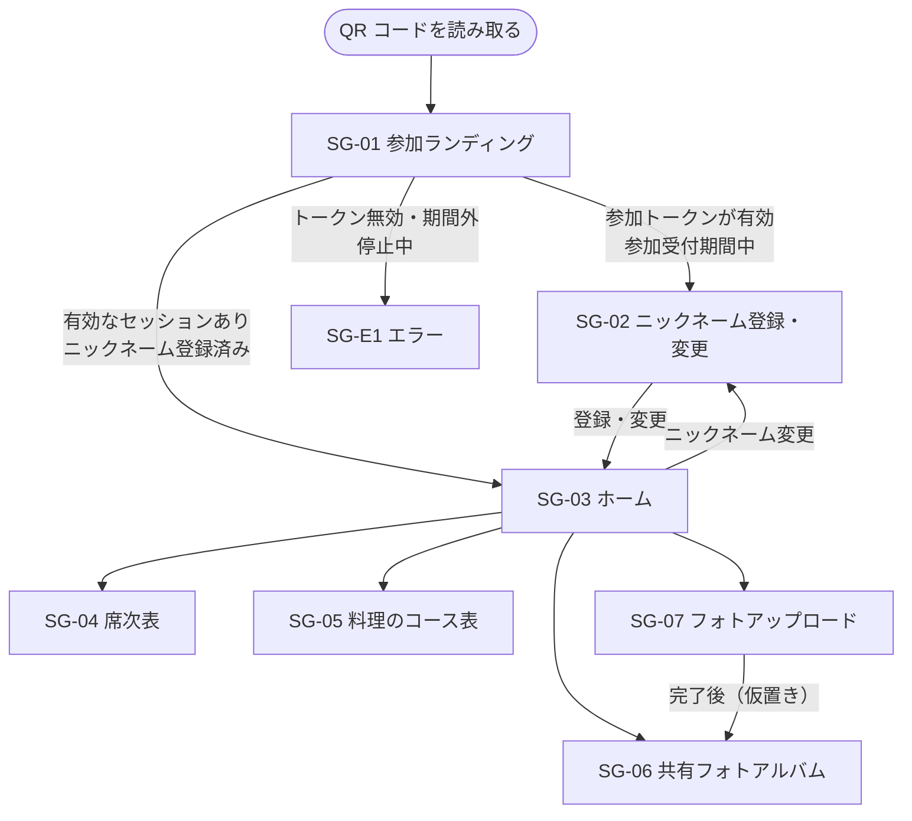
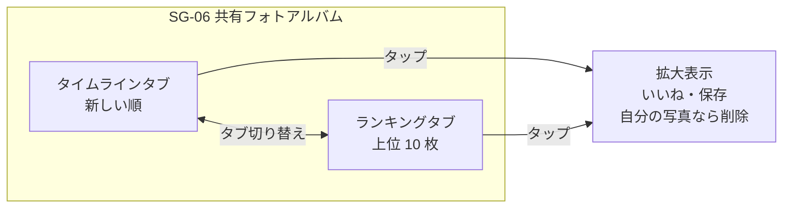
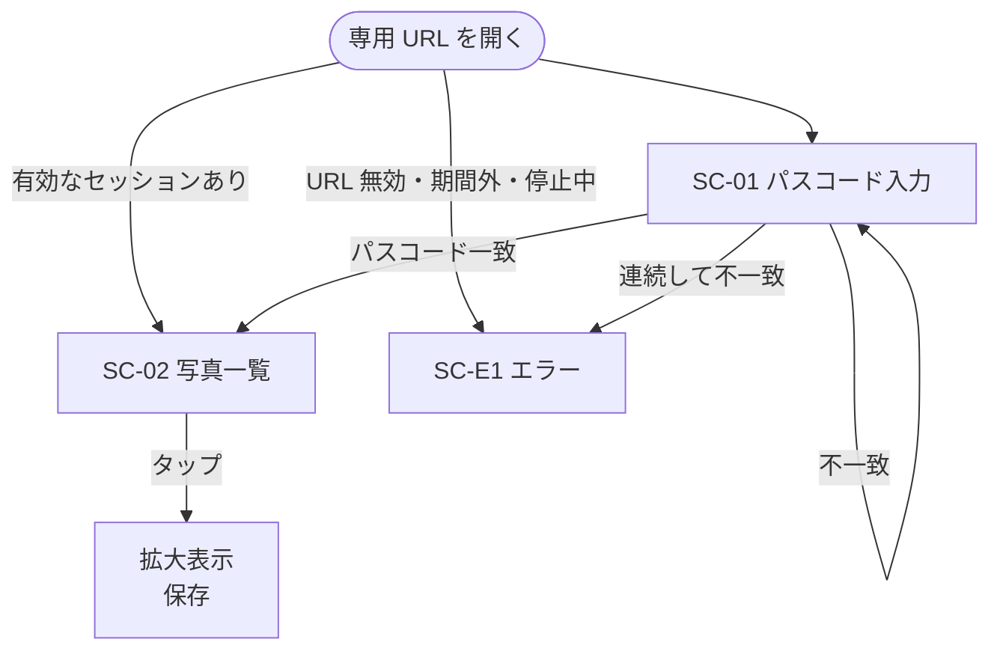
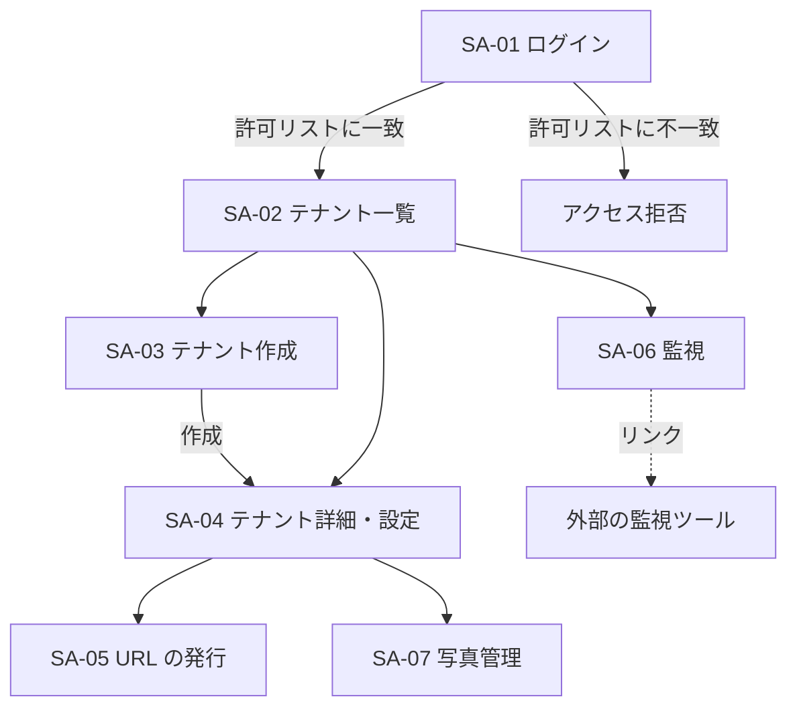

# 画面一覧・画面遷移

画面の構成要素は仮置き。レイアウトやデザインは別途決める。

## ユーザー画面（参加者）

| ID | 画面 | 概要 | 主な要素 | 機能要件 |
|---|---|---|---|---|
| SG-01 | 参加ランディング | QR コードの遷移先。参加トークンを検証してセッションを発行する | 処理中の表示 | FR-G-01, FR-G-02 |
| SG-02 | ニックネーム登録・変更 | 初回の登録と、ホームからの変更に使う | ニックネーム入力欄、登録ボタン、「この名前は使われています」の表示 | FR-G-03 |
| SG-03 | ホーム | 各ページへの入口 | テナント名、自分のニックネームと変更リンク、4 ページへのリンク | FR-G-04 |
| SG-04 | 席次表 | 席次表 PDF をインライン表示する | PDF ビューア | FR-G-05 |
| SG-05 | 料理のコース表 | コース表の画像を表示する | コース表の画像（拡大可） | FR-G-06 |
| SG-06 | 共有フォトアルバム | 写真の一覧。タイムラインとランキングの 2 タブ | タブ、写真の一覧（投稿者・いいね数）、再読み込み、拡大表示（いいね・保存・自分の写真なら削除） | FR-G-08〜FR-G-13 |
| SG-07 | フォトアップロード | 写真を 1 枚選んで投稿する | 写真の選択、アップロードボタン、進捗・結果の表示 | FR-G-07 |
| SG-E1 | エラー | 利用できない場合 | エラーの内容（参加受付期間外、参加トークン無効、閲覧期間の終了、停止中、セッションなし） | FR-G-01, FR-G-02 |

共通:

- SG-03 以外の画面からホームに戻れる（仮置き）
- セッションがない状態でユーザー画面のページにアクセスした場合は SG-E1 を表示し、受付の QR コードを読み取るよう案内する
- ニックネーム未登録の状態でユーザー画面のページにアクセスした場合は SG-02 に誘導する

### 画面遷移

### 共有フォトアルバムのタブ

## 新郎新婦用ページ

| ID | 画面 | 概要 | 主な要素 | 機能要件 |
|---|---|---|---|---|
| SC-01 | パスコード入力 | 専用 URL の遷移先。パスコードを入力して入る | パスコード入力欄、送信ボタン、失敗時の表示 | FR-C-01 |
| SC-02 | 写真一覧 | テナントの写真を確認・保存する | タブ（すべての写真 / ランキング）、投稿者での絞り込み、写真の一覧（投稿者・いいね数）、再読み込み、拡大表示（保存） | FR-C-02〜FR-C-05 |
| SC-E1 | エラー | 利用できない場合 | エラーの内容（URL 無効、期間外、停止中、入力回数の超過） | FR-C-01 |

### 画面遷移

## 管理面

| ID | 画面 | 概要 | 主な要素 | 機能要件 |
|---|---|---|---|---|
| SA-01 | ログイン | Google 認証でログインする | Google ログインボタン、アクセス拒否の表示 | FR-A-01 |
| SA-02 | テナント一覧 | 作成済みテナントの一覧 | テナント一覧（テナント名・開催日・現在の期間・停止中）、作成ボタン | FR-A-02 |
| SA-03 | テナント作成 | 新しいテナントを作成する | テナント名、開催日 | FR-A-03 |
| SA-04 | テナント詳細・設定 | テナントの設定を変更する | 基本情報、現在の期間、停止・再開、席次表 PDF、コース表の画像、利用状況、データの削除予定日 | FR-A-04, FR-A-05, FR-A-06, FR-A-10, FR-A-13 |
| SA-05 | URL の発行 | 参加 URL と新郎新婦用 URL の発行・再発行 | 参加 URL、QR コード画像とダウンロード、新郎新婦用 URL、パスコード（発行時のみ表示）、再発行ボタン | FR-A-07, FR-A-08, FR-A-12 |
| SA-06 | 監視 | 全テナントの利用状況を確認する | テナントごとの利用状況の一覧、外部の監視ツールへのリンク | FR-A-09, FR-A-10 |
| SA-07 | 写真管理 | テナントの写真を確認・削除する | 写真の一覧（投稿者・いいね数）、削除ボタン、削除の確認 | FR-A-11 |

### 画面遷移

