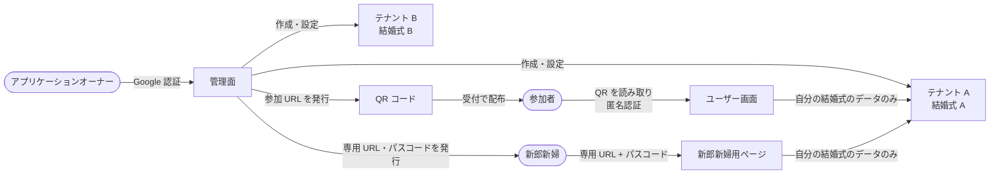

# プロダクト概要

## 何を作るか

結婚式の当日に、参加者がスマートフォンのブラウザから使う Web アプリケーション。
受付で配られた QR コードを読み取るだけで参加でき、席次表や料理のコース表を見たり、
撮った写真を参加者同士で共有して「いいね」を付け合ったりできる。
新郎新婦は専用のページから、式の後も参加者がアップロードした写真を確認できる。

1 つの結婚式を 1 つの**テナント**として扱うマルチテナント構成で、
アプリケーションオーナーが管理面から結婚式ごとにテナントを作成・設定する。

## 方針

- 参加者の認証の手間をできるだけ省く。参加者は匿名認証のみで、Basic 認証や Google 認証などは使わない
- 管理面には、権限を持つ人だけが Google 認証でログインできる
- 新郎新婦は、管理者から受け取った専用 URL とパスコードで新郎新婦用ページに入る
- テナントは UUID で識別し、データをテナントごとに分離する

## アクター

| アクター | 説明 | 使う画面 | 認証 |
|---|---|---|---|
| アプリケーションオーナー（管理者） | 本アプリの運営者。テナントの作成・設定・監視を行う | 管理面 | Google 認証（許可リストのアカウントのみ） |
| 新郎新婦 | 結婚式の主役。式の後も、アップロードされた写真を確認する | 新郎新婦用ページ | 専用 URL + パスコード |
| 参加者（ゲスト） | 結婚式の参加者。受付で QR コードを受け取る | ユーザー画面 | 匿名認証 |

> 新郎新婦も、当日は参加者として QR コードから参加し、写真を投稿・いいねできる（仮置き）。

## 3 つの画面

### 管理面

- 利用者: アプリケーションオーナー権限を持つ人のみ
- できること: テナントの作成・設定・停止、参加 URL と新郎新婦用 URL の発行、写真の削除、利用状況の確認
- 詳細: [requirements/functional-admin.md](requirements/functional-admin.md)

### ユーザー画面

- 利用者: 各テナント（結婚式）の参加者
- できること: 席次表・料理のコース表の閲覧、写真のアップロード・削除、共有フォトアルバムの閲覧・いいね・保存
- 詳細: [requirements/functional-guest.md](requirements/functional-guest.md)

### 新郎新婦用ページ

- 利用者: 各テナントの新郎新婦
- できること: 写真の閲覧・保存、いいね数・ランキングの確認、投稿者での絞り込み
- 詳細: [requirements/functional-couple.md](requirements/functional-couple.md)

## 全体像

## テナントの期間

テナントの期間は、開催日をもとに自動で切り替わる（[D-23](open-questions.md)）。日付の境界は日本時間で判定する（仮置き）。

| 期間 | 範囲 | 参加者 | 新郎新婦 |
|---|---|---|---|
| 準備期間 | テナント作成 〜 開催日の前日 | 参加できない | 利用できる |
| 参加受付期間 | 開催日当日 〜 翌日 | 参加でき、すべての機能を使える | 利用できる |
| 閲覧期間 | 開催日の翌々日 〜 3 か月後 | 新しく参加できない。参加済みの人はすべての機能を使える | 利用できる |
| 新郎新婦閲覧期間 | 開催日の 3 か月後 〜 6 か月後 | 利用できない | 利用できる |
| 削除済み | 開催日の 6 か月後以降 | データを削除する（FR-A-13） | 利用できない |

管理者がテナントを**停止**している間は、期間にかかわらず参加者・新郎新婦とも利用できない（FR-A-04）。

## 利用の流れ

| 時期 | 誰が | 何をする |
|---|---|---|
| 準備期間 | 管理者 | テナントを作成する（開催日を登録する） |
| 準備期間 | 管理者 | 席次表 PDF と料理のコース表の画像を登録する |
| 準備期間 | 管理者 | 参加 URL を発行して QR コードにする。新郎新婦用の専用 URL とパスコードを発行して二人に渡す |
| 開催日・受付 | 受付 | 参加者に QR コードを配布する |
| 参加受付期間 | 参加者 | QR コードを読み取って参加し、ニックネームを登録する |
| 参加受付期間・閲覧期間 | 参加者 | 席次表・コース表を見る、写真を投稿・削除する、写真にいいね・保存する |
| 開催日以降 | 新郎新婦 | 新郎新婦用ページで写真を確認・保存する |
| 開催日の 6 か月後 | システム | テナントのデータを自動で削除する |

## 用語集

| 用語 | 意味 |
|---|---|
| テナント | 1 つの結婚式に対応する単位。UUID で識別し、データはテナントごとに分離する |
| 開催日 | 結婚式の日付。テナントの期間はすべて開催日を起点に決まる |
| アプリケーションオーナー / 管理者 | 管理面にログインできる権限を持つ人 |
| 新郎新婦 | 結婚式の主役。新郎新婦用ページを使う |
| 参加者 / ゲスト | 結婚式の参加者。ユーザー画面を匿名認証で使う |
| 参加 URL | 参加者がユーザー画面に入るための URL。テナント ID と参加トークンを含む。管理面で発行し、QR コードにして配布する |
| 参加トークン | 参加 URL に含まれる推測困難な文字列。同じテナントの参加者全員で共通。開催日当日〜翌日だけ有効 |
| 新郎新婦用 URL | 新郎新婦が新郎新婦用ページに入るための URL。管理者が発行して二人に渡す |
| パスコード | 新郎新婦用ページに入るときに入力する文字列。新郎新婦用 URL とは別に伝える |
| 匿名認証 | アカウント登録やパスワードなしで、参加者をブラウザ単位で識別する認証方式 |
| セッショントークン | 認証の結果としてブラウザに保存され、以降のアクセスで利用者を識別するトークン |
| ニックネーム | 参加者が最初に登録する表示名。テナント内で重複しない |
| 共有フォトアルバム | テナント内の参加者が投稿した写真を見るページ。タイムラインとランキングの 2 タブで構成する |
| タイムライン | すべての参加者が投稿した写真を新しい順に並べたタブ |
| ランキング | いいね数の多い写真の上位 10 枚を並べたタブ |
| いいね | 写真に付ける評価。ランキングの集計に使う |
| 保存 | 写真を自分の端末にダウンロードすること |
| 席次表 | テナントごとに登録する PDF。ユーザー画面でインライン表示する |
| 料理のコース表 | テナントごとに登録する画像。ユーザー画面で表示する |
| 停止 | 管理者が手動でテナントを利用できなくすること。再開できる |
