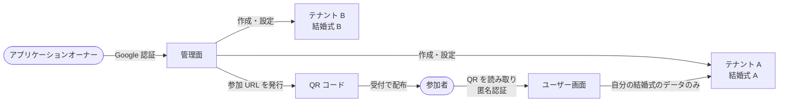

# プロダクト概要

## 何を作るか

結婚式の当日に、参加者がスマートフォンのブラウザから使う Web アプリケーション。
受付で配られた QR コードを読み取るだけで参加でき、席次表や料理のコース表を見たり、
撮った写真を参加者同士で共有して「いいね」を付け合ったりできる。

1 つの結婚式を 1 つの**テナント**として扱うマルチテナント構成で、
アプリケーションオーナーが管理面から結婚式ごとにテナントを作成・設定する。

## 方針

- 参加者の認証の手間をできるだけ省く。参加者は匿名認証のみで、Basic 認証や Google 認証などは使わない
- 管理面には、権限を持つ人だけが Google 認証でログインできる
- テナントは UUID で識別し、データをテナントごとに分離する

## アクター

| アクター | 説明 | 使う画面 | 認証 |
|---|---|---|---|
| アプリケーションオーナー（管理者） | 本アプリの運営者。テナントの作成・設定・監視を行う | 管理面 | Google 認証（権限を持つアカウントのみ） |
| 参加者（ゲスト） | 結婚式の参加者。受付で QR コードを受け取る | ユーザー画面 | 匿名認証 |

> 新郎新婦専用の役割は現時点では定義していない。新郎新婦も参加者としてユーザー画面を使う想定（仮置き、[OQ-12](open-questions.md)）。

## 2 つの画面

### 管理面

- 利用者: アプリケーションオーナー権限を持つ人のみ
- できること: テナントの作成、参加 URL の発行、テナント設定、ログ・メトリクスの監視
- 詳細: [requirements/functional-admin.md](requirements/functional-admin.md)

### ユーザー画面

- 利用者: 各テナント（結婚式）の参加者
- できること: 席次表の閲覧、料理のコース表の閲覧、写真のアップロード、共有フォトアルバムの閲覧・いいね・保存
- 詳細: [requirements/functional-guest.md](requirements/functional-guest.md)

## 全体像

## 利用の流れ

| フェーズ | 誰が | 何をする |
|---|---|---|
| 事前準備 | 管理者 | テナントを作成する |
| 事前準備 | 管理者 | 席次表 PDF と料理のコース表を登録する |
| 事前準備 | 管理者 | 参加 URL を発行し、QR コードにする |
| 当日・受付 | 受付 | 参加者に QR コードを配布する |
| 当日・式中 | 参加者 | QR コードを読み取って参加し、ニックネームを登録する |
| 当日・式中 | 参加者 | 席次表・コース表を見る、写真を投稿する、写真にいいね・保存する |
| 式後 | — | 閲覧できる期間・データの保持期間は未定（[OQ-13](open-questions.md)） |

## 用語集

| 用語 | 意味 |
|---|---|
| テナント | 1 つの結婚式に対応する単位。UUID で識別し、データはテナントごとに分離する |
| アプリケーションオーナー / 管理者 | 管理面にログインできる権限を持つ人 |
| 参加者 / ゲスト | 結婚式の参加者。ユーザー画面を匿名認証で使う |
| 参加 URL | 参加者がユーザー画面に入るための URL。テナント ID と参加トークンを含む。管理面で発行し、QR コードにして配布する |
| 参加トークン | 参加 URL に含まれる推測困難な文字列。同じテナントの参加者全員で共通 |
| 匿名認証 | アカウント登録やパスワードなしで、参加者をブラウザ単位で識別する認証方式 |
| セッショントークン | 匿名認証の結果としてブラウザに保存され、以降のアクセスで参加者を識別するトークン |
| ニックネーム | 参加者が最初に登録する表示名 |
| 共有フォトアルバム | テナント内の参加者が投稿した写真を見るページ。タイムラインとランキングの 2 タブで構成する |
| タイムライン | すべての参加者が投稿した写真を並べたタブ |
| ランキング | 写真をいいね数の多い順に並べたタブ |
| いいね | 他の参加者の写真に付ける評価。ランキングの集計に使う |
| 保存 | 写真を自分の端末にダウンロードすること |
| 席次表 | テナントごとに登録する PDF。ユーザー画面でインライン表示する |
| 料理のコース表 | テナントごとの料理のコースを表示する静的ページ |
